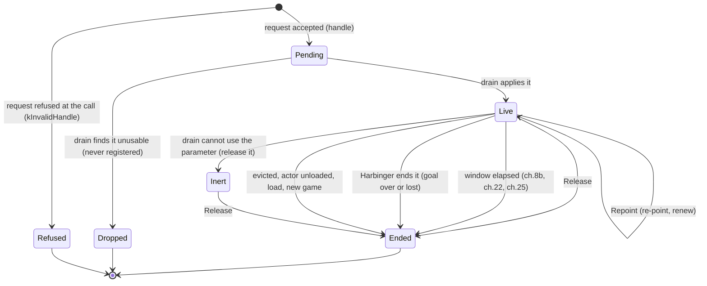

# Harbinger for mod authors: the guide

Harbinger (the project is APMF, the AI Package Management Framework) is an SKSE plugin that lets several mods direct one NPC at once without fighting over it. This page teaches the model a mod author needs before using it from their own DLL: what a facet is, how claims are ranked, how a claim lives and dies, which thread does what, and how to bind and read the result. It is the first of four pages written for mod authors.

| Page | What it is for |
|---|---|
| **This page, `GUIDE.md`** | the foundations: facets, claims, basis and priority, threading, binding |
| [FACETS.md](FACETS.md) | the reference: one section per facet, with its arguments, rules, examples and field status |
| [RECIPES.md](RECIPES.md) | worked scenarios that combine facets, with complete code |
| [GLOSSARY.md](GLOSSARY.md) | every term, defined once, with where it is introduced |

[INTEGRATION.md](INTEGRATION.md) is the ten-minute quickstart. [`native/APMF_API.h`](../native/APMF_API.h) is the contract, and if any page here and the header ever disagree, the header wins. Every C++ example on these pages compiles against that header as it stands today (ABI 30, release 0.15.1). The player-facing pages are [INI-REFERENCE.md](INI-REFERENCE.md) and [HARBINGER-MENU.md](HARBINGER-MENU.md).

**How the pages are written.** Each major section opens with a short summary in italics. A topic says why it matters, states the rule, then gives the mechanism behind it, and ends with **Check Your Understanding**, two or three questions to try, with the odd-numbered answers at the end of the page. Five kinds of callout appear: **Key Concept** (a rule stated precisely, numbered within the page), **Tip**, **Caution** (a misuse that breaks something), **Real-World Connection** (how MFO, the reference client, uses it) and **Did You Know?** (an engine fact behind a rule). Worked examples give a goal, **Think it through**, a **Solution** that compiles, and a **Check** for the game or the log. Where something has not been seen working in game, or is not known, the text says so.

**Conventions.** Distances are in game units unless a section says otherwise (one foot is 64 over 3 units, so about 71 units is one metre). Angles are radians. A window is milliseconds in the cast request and seconds in `APMF_Param.fval`, and each facet section says which. FormIDs are plain `RE::FormID` values (`std::uint32_t`). `0x14` is the player. A FormID names an object reference (a loaded actor, a marker, a container) except where a section says it is a base form (a spell, an idle, a package, an item). "ch.N" is Harbinger's channel number, the log tag. One header detail: `APMF_Param` carries a world point as three floats, `posX`, `posY` and `posZ`. Older header comments call it `param.pos`. There is no `pos` member.

**The examples on this page** assume this much, which [Binding and Version Gating](#binding-and-version-gating) builds.

```cpp prelude
#include "APMF_API.h"
#include <chrono>
#include <cstdint>
using namespace APMF_API;

extern const APMF_API_v29* g_apmf;   // bound once at startup
constexpr float kBasis = 50.0f;      // your choice of basis. MFO uses 200
```

## What Harbinger Is

*Skyrim gives one actor to one mod at a time. Harbinger splits an actor's AI into small facets, lets each mod claim only the facet it needs, and makes that claim reach the engine while it stands.*

### The problem

**Why it matters.** If you have shipped a mod that moves or directs NPCs, you have probably met this problem already. It is worth stating plainly, because it is the thing Harbinger changes.

Skyrim gives one actor to one AI package at a time. The package with the highest priority that passes its conditions wins, and every other package waits. A follower framework that holds a follower in its own package has, by that rule, locked every other mod out of that follower. A second mod that wants the follower to walk somewhere, cast a spell at someone, or stay out of a fight has to take the whole actor, and then the framework loses. Both mods are right and one of them breaks.

The same lock exists one level down. The combat AI chooses the target, the spell, the hand, the attack and the movement from inputs it reads each update. Two mods that each hook one of those decisions overwrite each other in an order neither controls, and the player sees a follower that casts the wrong spell, chases the wrong foe, or stands still for no reason.

> **Did You Know?** The engine's own package system has no notion of sharing. `CheckForCurrentAliasPackage` (the `Character` virtual function at slot 0x49) answers one package, and whatever answered last wins. Harbinger's package channel sits on that one question, which is why a package offer can be redirected without touching the package stack. [Offer package](FACETS.md#ch9-offer-package-kintent_offerpackage) has the details.

**Check Your Understanding: The problem**

1. A follower framework holds a follower in a package at priority 100. Your mod offers a travel package at priority 110. What happens to the framework's package while yours runs, and what happens when yours ends?
2. Name two engine decisions, other than the package, that two mods could overwrite in each other.

### A moderator, not a driver

**Why it matters.** Every design choice in the API follows from one fact: Harbinger decides nothing on its own. A client that expects it to choose a target or plan a route ends up fighting the API, so it is worth settling first.

Harbinger sits between the mods and the engine. A mod does not take the actor. It **claims one facet** of the actor, a single input the AI reads, at a rank of its choosing, and Harbinger makes that claim reach the engine while it stands. Everything else about the actor keeps running under its own AI. Its package stays current, its combat keeps going, its other decisions are untouched. When the claim ends, the facet goes straight back to the actor's own AI, or to the next best claim.

> **Key Concept 1 (the moderator)** Harbinger arbitrates who owns each facet of an actor and denies the losing inputs. It generates no behaviour. It never chooses a target, picks a spell, plans a path or decides to attack. The client declares what and where. Harbinger enforces exactly what was declared and nothing more.

A channel works in one of three modes, and the mode tells you what to expect from a claim (Table 1).

**Table 1. The three modes of a channel**

| Mode | What Harbinger does | Example |
|---|---|---|
| **Arbitrate** | Records who owns the facet. The client drives it with its own mechanism. Harbinger calls nothing | combat target (ch.6), shout (ch.14) |
| **Deny** | Suppresses a competing input at its source: an actor value, a vfunc answer, a package offer, a behaviour-tree leaf. Nothing is re-asserted | movement block (ch.1), combat action (ch.7), re-entry deny (ch.22) |
| **Promote** | Makes one bounded engine call at engage or release, and no more. No tick, no re-assert | stance (ch.3), weapon draw (ch.4), idle (ch.12) |

The cast facet (ch.8b) combines arbitrate and deny with a fourth element, **compose**: Harbinger answers the engine's own cast-decision questions for the claim, so that the NPC's own AI selects, equips, charges, aims and fires the spell the client named. Harbinger still makes no cast call. [Cast](FACETS.md#ch8b-cast-kintent_cast) has the details.

> **Real-World Connection** MFO (marth's Follower Overhaul) is Harbinger's first client. Before Harbinger, MFO forced casts with its own `CastSpellImmediate` calls and got a cast with no animation. With the cast facet it declares the spell and the target and the follower's own AI casts it, animated, because the game is the one casting.

**Check Your Understanding: A moderator, not a driver**

1. Which mode makes an engine call, and when?
2. A client claims the cast facet and expects Harbinger to pick the best heal spell for the situation. What is wrong with that expectation?
3. In which mode does Harbinger write nothing at all to the engine?

### The rules it never breaks

**Why it matters.** These five rules are what make Harbinger safe to install beside mods that know nothing about it. They are stated once here and assumed on every other page.

> **Key Concept 2 (chainable hooks)** Harbinger never overwrites another mod's hook. Every deny gate calls through to whatever answered before it and only turns a yes into a no for the one thing it denies.

The one exception is the equip authority seat ([Equip authority](FACETS.md#ch17-equip-authority-kintent_equipauthority)), which has no virtual function on its path. It patches two internal call sites, byte-verifies both first, and refuses to install if anyone else touched them. A collision there is a missing feature, never a crash.

> **Key Concept 3 (engine answer first)** A deny gate lets the engine, or the next hook in the chain, answer first. Harbinger never invents a yes.

The cast facet has one bounded, documented exception: one equip seat that has to be answered from the claim, because the engine would otherwise never consider the claimed spell.

> **Key Concept 4 (one input, not a whole system)** A claim covers exactly one facet. A facet never claims another facet on your behalf. If a scenario needs three facets, it needs three claims.

An actor whose cast choice is claimed keeps moving, fighting and reacting under its own AI. The travel facet walks the actor and does nothing else.

> **Key Concept 5 (reversible on release)** When the last claim on a facet releases, the suppression stops. There is no re-assert loop and no override left behind to clean up.

The one standing exception, the headtrack channel's per-tick re-apply, is marked as a known stopgap under [Headtrack](FACETS.md#ch5-headtrack-kintent_headtrack).

> **Key Concept 6 (never deny what it cannot name)** Harbinger enforces only against a positively identified source that has been outranked. A write it cannot attribute is allowed, logged as `[sources] UNATTRIBUTED <facet>` and shown as an alert on the menu page.

[Sources, Priority and Arbitration](#sources-priority-and-arbitration) explains how a source is named and ranked.

**Check Your Understanding: The rules it never breaks**

1. Another mod hooks the same virtual function Harbinger's cast gate uses, after Harbinger loaded. Which rule says what happens, and what does happen?
2. Why is the equip authority seat allowed to break the chainable-hooks rule, and what does it do instead of crashing?
3. A script changes a follower's `SpeedMult` while your gait claim holds it. Is the script's change refused?

### Where it runs and what you bring

**Why it matters.** Your mod will be installed on runtimes Harbinger refuses, and beside Harbinger versions older than the one you built against. The degrade path is part of your design, not an afterthought.

Harbinger runs on Skyrim AE 1.6.1170, SE 1.5.97 and 1.7.104 (Steam), behind exact-version gates. Every other build, and VR, is refused by name at load, and from then on every claim is refused at the call ([The two refusal timings](#the-two-refusal-timings)). A client never has to test the runtime itself. It tests the handle it gets back.

> **Key Concept 7 (a refusal means do it your own way)** A request that returns `kInvalidHandle` was refused, and the reason is in `APMF.log`. Harbinger refuses rather than accepting a claim that would silently do nothing, so your own mechanism for that facet, your **degrade path**, runs.

For most facets the client brings the behaviour. It writes the combat target with its own call, equips the weapon it wants, runs its own package. Harbinger makes sure the facet is the client's while the claim stands. For a few facets Harbinger makes a small engine call because the client declared it. Table 2 lists every such call.

**Table 2. The engine calls a facet makes on your behalf**

| Facet | Call | When |
|---|---|---|
| Movement block (ch.1) | `KeepOffsetFromActor` on itself, `SetDontMove(true)` | at engage, undone at release |
| Stance (ch.3) | the `SneakStart` and `SneakStop` animation events | at engage and release |
| Weapon drawn (ch.4) | `DrawWeaponMagicHands(true)`, then `(false)` | at engage and release |
| Dialogue (ch.10) | `PauseCurrentDialogue()` | once, at engage |
| Idle (ch.12) | `IdleForceDefaultState`, or `PlayIdle(actor, idle, target)` | at engage, on `Repoint`, at release |
| Offer package (ch.9), Travel (ch.19) | an `EvaluatePackage` nudge | at engage, owner change and release |
| Equip authority (ch.17) | `EquipObject` for each declared item not worn | once per declaration |
| Combat entry (ch.21) | `StartCombat(target)` | once per declaration |
| Position cast | `CastSpellImmediate` from a temporary marker | once |
| Combat substrate (ch.27) | `StartCombat(anchor)` against Harbinger's own stand-in, then `StopCombat` | once at the open, once at the close |
| Place | the game's own move call (`MoveTo_Impl`, the body Papyrus `MoveTo` runs) | once, on the game thread |

The combat substrate also stows the follower's weapon, shield and torch before its entry and puts the same copies back at the close, and the game's own AI equips the claimed spell. A combat re-entry deny (ch.22) calls nothing. It makes the engine's own `StartCombat` refuse. The cast facet (ch.8b) makes no equip, cast or animation call of any kind.

**Check Your Understanding: Where it runs and what you bring**

1. Your mod is installed on Skyrim 1.6.640. What does `RequestEx` return, and what should your mod do?
2. Which facet makes an engine call at release that happens whatever the state was before the claim?

### Summary: What Harbinger Is

- One actor, one package: the engine has no notion of sharing, so mods that direct NPCs break each other.
- Harbinger is a moderator. A mod claims one facet, Harbinger routes it, and the rest of the actor runs untouched.
- A channel arbitrates, denies or promotes. The cast channel also composes, by answering the engine's own cast questions.
- Five rules hold everywhere: chainable hooks, engine answer first, one input, reversible on release, never deny the unnamed.
- Three runtimes are served. Everywhere else every claim is refused at the call, and a refusal means run your own degrade path.

**Try this.** Explain to a fellow modder, in a paragraph, why a follower framework and a loot mod cannot both direct one follower without a moderator. Then take a stance claim, a combat target claim, a combat re-entry deny and an idle claim with a form, and say which mode each is and which engine call, if any, Harbinger makes.

## The AI Facet

*A facet is the smallest thing a mod can take from an actor's AI without taking something it did not ask for. Every claim names exactly one.*

### What a facet is

**Why it matters.** It is easy to treat a facet as a behaviour ("walk to the crate and loot it") and claim too little, then wonder why the follower stood still with its hands full. It is as easy to treat it as a package and claim too much. The definition decides the design.

> **Key Concept 8 (the facet)** A facet is one input the engine's AI reads when it decides one thing about an actor.

The combat target is a facet. Which spell may enter a hand is a facet. Whether the actor may start combat is a facet. Where the actor's movement goal is parked is a facet. A facet is small on purpose.

A facet is **not** a package, a behaviour, or a goal. "Walk to the crate and loot it" is at least three facets (a travel leg, a stand-still and an animation), each claimed on its own. The travel facet ([Travel](FACETS.md#ch19-travel-kintent_travel)) is the clearest case: it walks the actor and does nothing else. It enters no combat, pins no target and holds no hand.

> **Tip** When you plan a scenario, write down every engine decision the NPC will have to make differently, then claim one facet per decision. If the list has a decision no facet covers, that is a gap to report, not something to fake with a bigger claim.

**Check Your Understanding: What a facet is**

1. "Make the follower fight the bandit I point at" names how many facets? Name them ([Combat](FACETS.md#combat) has them).
2. Is "the actor's running package" a facet in Harbinger's sense? What does the offer-package facet claim instead?

### Intent, channel and sources facet

**Why it matters.** Three words appear in the API, the log and the menu, and they point at the same facet from three sides. Reading a log line without knowing which is which costs time.

**Table 3. Three names for one facet**

| Word | Where it appears | What it is |
|---|---|---|
| **Intent** | the API (`kIntent_Cast`) | the facet's name in a claim. One intent is one facet |
| **Channel** | the log (`[ch.8b]`), the code (`native/channels/`) | Harbinger's implementation of that facet. Channels are numbered, and the number is the log tag |
| **Sources facet** | `APMF_Sources.ini`, the menu page | a coarser group of channels that share one priority table: `Target`, `Package`, `EquipWeapon`, `EquipArmor`, `CombatAction`, `Cast`, `Combat`, `Detection`, `ActorValue`, `Core`. (Equip was one table until 0.14.0. An old `[Equip]` section is still read where the new ones have no value) |

So the cast facet is `kIntent_Cast` to a client, `ch.8b` in the log, and part of the `Cast` sources facet when priorities are compared. These pages name a facet by its channel and its intent together, for example "ch.8b Cast (`kIntent_Cast`)".

**Check Your Understanding: Intent, channel and sources facet**

1. A log line reads `[ch.22] seat OBSERVED`. Which intent is that, and which sources facet does its priority come from?
2. Two intents share the `Target` sources facet. Which are they?

### The catalogue

**Why it matters.** This is the one table to come back to. It names every facet, says how it acts, which priority table it uses, which ABI first served it, and how far the project trusts it in the field.

**Table 4. The facet catalogue**

| Intent | ch. | Facet | Mode | Sources facet | ABI | Tier | Reference |
|---|---|---|---|---|---|---|---|
| `kIntent_MovementBlock` | 1 | Stand the actor still | deny | Core | 1 | Field-proven (MFO) | [ch.1](FACETS.md#ch1-movement-block-kintent_movementblock) |
| `kIntent_Gait` | 1a | Halve the actor's speed | deny | ActorValue | 1 | Field-proven | [ch.1a](FACETS.md#ch1a-gait-kintent_gait) |
| `kIntent_Stance` | 3 | Make the actor sneak | promote | Core | 1 | Field-proven | [ch.3](FACETS.md#ch3-stance-kintent_stance) |
| `kIntent_WeaponDrawn` | 4 | Draw the weapon, sheathe on release | promote | Core | 1 | Built | [ch.4](FACETS.md#ch4-weapon-drawn-kintent_weapondrawn) |
| `kIntent_Headtrack` | 5 | Make the actor look up (a test facet) | deny | Core | 1 | Field-proven, known incomplete | [ch.5](FACETS.md#ch5-headtrack-kintent_headtrack) |
| `kIntent_Dialogue` | 10 | Pause the actor's own dialogue once | deny (one-shot) | Core | 1 | Built | [ch.10](FACETS.md#ch10-dialogue-kintent_dialogue) |
| `kIntent_Idle` | 12 | Play an idle, optionally at a target | promote | Core | 1, form 17 | Field-proven (MFO) | [ch.12](FACETS.md#ch12-idle-kintent_idle) |
| `kIntent_Disposition` | 11 | Make the actor aggressive and loyal | deny | ActorValue | 1 | Field-proven | [ch.11](FACETS.md#ch11-disposition-kintent_disposition) |
| `kIntent_Detection` | 16 | Silent movement, longer detect range | deny | Detection | 1 | Field-proven | [ch.16](FACETS.md#ch16-detection-kintent_detection) |
| `kIntent_SelectSpell` | 8 | The only spells the AI may cast | arbitrate + deny | Cast | 2 | Field-proven (one spell) | [ch.8](FACETS.md#ch8-select-spell-kintent_selectspell) |
| `kIntent_Cast` | 8b | The AI casts a spell at a target, animated | arbitrate + deny + compose | Cast | 5 | Field-proven (MFO) | [ch.8b](FACETS.md#ch8b-cast-kintent_cast) |
| `kCastFlag_AtPosition` | 8b | A Target Location spell at a point (one-shot) | one engine call | none | 11 | Built, off by default | [position cast](FACETS.md#position-cast-kcastflag_atposition) |
| `kIntent_ShoutPower` | 14 | Record who owns the shout facet | arbitrate | Core | 1 | Built | [ch.14](FACETS.md#ch14-shout-and-power-kintent_shoutpower) |
| `kIntent_CastGuard` | 25 | Hold attack spells through friends, bound channels | deny | Cast | 21 | Field-proven (MFO) | [ch.25](FACETS.md#ch25-cast-guard-kintent_castguard) |
| `kIntent_Equipment` | 15 | Gate spell and staff re-arm | deny | EquipWeapon | 1 | Field-proven (MFO) | [ch.15](FACETS.md#ch15-equipment-kintent_equipment) |
| `kIntent_EquipAuthority` | 17 | Declare what the actor wears, refuse the rest | arbitrate + deny + one equip | EquipWeapon, EquipArmor | 7 | Field-proven (MFO), every category enforced by default since 0.14.0 | [ch.17](FACETS.md#ch17-equip-authority-kintent_equipauthority) |
| `kIntent_OfferPackage` | 9 | Hand the actor one package | deny | Package | 1 | Proven when nudged | [ch.9](FACETS.md#ch9-offer-package-kintent_offerpackage) |
| `kIntent_Travel` | 19 | Walk the actor to a place, across cells with `kTravel_CrossCells` | deny (an internal ch.9) | Package | 10 (cross cells 30) | In use by MFO | [ch.19](FACETS.md#ch19-travel-kintent_travel) |
| `kIntent_CombatTarget` | 6 | Record who owns the combat target | arbitrate | Target | 1 | Field-proven (arbitration only) | [ch.6](FACETS.md#ch6-combat-target-kintent_combattarget) |
| `kIntent_CombatAction` | 7 | Deny categories of combat behaviour | deny | CombatAction | 1 | Field-proven | [ch.7](FACETS.md#ch7-combat-action-kintent_combataction) |
| `kIntent_TargetPin` | 20 | Hold the engine's combat target on yours | deny | Target | 13 | Field-proven (MFO) | [ch.20](FACETS.md#ch20-target-pin-kintent_targetpin) |
| `kIntent_CombatEntry` | 21 | Start a fight with one `StartCombat` | one engine call | Combat | 14 | Field-proven (MFO) | [ch.21](FACETS.md#ch21-combat-entry-kintent_combatentry) |
| `kIntent_CombatReentryDeny` | 22 | Keep the actor out of combat for a while | deny | Combat | 15 | Field-proven (MFO, 2026-09-28) | [ch.22](FACETS.md#ch22-combat-re-entry-deny-kintent_combatreentrydeny) |
| `kIntent_PursuitLeash` | 23 | Stop the actor chasing far from an anchor | deny | CombatAction | 16 | Field-proven (MFO) | [ch.23](FACETS.md#ch23-pursuit-leash-kintent_pursuitleash) |
| `kIntent_CombatApproach` | 24 | Close on an actor while fighting | deny + substitute | Combat | 19 | Field-proven (MFO) | [ch.24](FACETS.md#ch24-combat-approach-kintent_combatapproach) |
| `kIntent_EquipPreference` | 26 | Name the items the actor should favour in combat | weight (lifts a score) | EquipWeapon | 22 | Built, not yet tested in game | [ch.26](FACETS.md#ch26-equip-preference-kintent_equippreference) |
| `kIntent_CombatSubstrate` | 27 | Combat as a substrate so an out of combat cast is animated | deny + compose | CombatAction, Combat, EquipWeapon, Detection, Cast | 23 | Field tested on LoreRim in 0.15.1 for out of combat casts | [ch.27](FACETS.md#combat-substrate-kintent_combatsubstrate) |
| `kIntent_Place` | 28 | Put an actor, loaded or not, beside a reference or at an interior point, once | one engine call | none | 28 | Built, not yet tested in game | [Place](FACETS.md#place-kintent_place) |

Channel 18 is skipped on purpose. The number is reserved for an attack-selection design that is not on main. Channel 2 has no intent either, and nothing is reserved for it. The field tiers are defined under [The field tiers](#the-field-tiers).

Three things are not facets, because they claim nothing: the [read-only queries](FACETS.md#read-only-queries-no-claim), the [observe-only seats](FACETS.md#observe-only-facets-no-claim-api), and the position cast, which is a **one-shot** engine call that returns a handle for log correlation only. `kIntent_Place` is the same shape: a one-shot that returns a handle for `GetPlaceState`, never a live claim.

**Reserved fields.** Several channels apply a fixed built-in effect and read no parameter. Gait halves the speed, Disposition sets four fixed values, Detection sets two, Headtrack looks straight up, Stance sneaks. The `fval` and `form` fields those intents might one day read are **reserved**: accepted, stored and ignored. Each facet section says so, so that nobody designs around a field that does nothing yet. Table 5 is the quick scan of which intent reads which field today.

**Table 5. Which `APMF_Param` field each intent reads today**

| Intent | `form` | `fval` | `ival` | `target` | `posX/Y/Z` |
|---|---|---|---|---|---|
| `kIntent_SelectSpell` | the spell | | retired | retired | reserved |
| `kIntent_Cast` (degenerate `RequestEx`) | the spell | | `CastFlags` | | the point, with `kCastFlag_AtPosition` |
| `kIntent_CombatTarget` | the target actor (recorded) | | | | |
| `kIntent_ShoutPower` | the shout (recorded) | | | | |
| `kIntent_OfferPackage` | the package | | | | |
| `kIntent_Equipment` | the weapon (gate-only) | | reserved | | |
| `kIntent_CombatAction` | | | `CombatActionCategory` | | |
| `kIntent_EquipAuthority` | | | `EquipAuthFlags` | | |
| `kIntent_Travel` | the destination | arrival radius | `TravelFlags` (`kTravel_CrossCells` is ABI 30) | | the point, with `kTravel_ToPosition` |
| `kIntent_Idle` | the idle (ABI 17) | | | the reference to play at (ABI 17) | |
| `kIntent_TargetPin` | the target actor | | `TargetPinFlags` (ABI 18) | | |
| `kIntent_CombatEntry` | the target actor | | | | |
| `kIntent_CombatReentryDeny` | | the window, seconds | | | |
| `kIntent_PursuitLeash` | | the radius | | the anchor | |
| `kIntent_CombatApproach` | | the radius | `CombatApproachFlags` | X, the reference | |
| `kIntent_CastGuard` | | the window, seconds | `CastGuardFlags` | | |
| `kIntent_EquipPreference` | | | `EquipPrefFlags` (the items go through `SetEquipPreference`) | | |
| `kIntent_CombatSubstrate` | | the time limit, seconds (0 = the INI value) | | | |
| `kIntent_Place` | a reference, or an interior cell | the yaw, with `kPlace_SetYaw` | `PlaceFlags` | | the offset, or the point in the cell |
| every other intent | reserved | reserved | reserved | | |

A field a facet does not read is accepted and ignored, with one exception: a non-zero point on a travel claim without `kTravel_ToPosition` is refused by name.

**Check Your Understanding: The catalogue**

1. Which intent is served from ABI 10 with no new struct and no new function pointer? How does an older Harbinger answer a request for it?
2. Which three API things claim nothing, and why does one of them still return a handle?
3. A client sets `fval = 0.25f` on a gait claim expecting a quarter speed. What does it get?

### Summary: The AI Facet

- A facet is one input the AI reads for one decision. It is not a package, a goal or a behaviour.
- Intent, channel and sources facet are three names for one facet, from the API, the log and the priority table.
- The catalogue lists every facet with its mode, ABI, sources facet and field tier.
- Several channels read no parameter today. A reserved field is accepted and ignored.

**Try this.** Pick a follower behaviour from a mod you know and decompose it into facets using the catalogue. Mark any decision no facet covers. Then, from the field table, list every intent that reads `target` and say what each reads it as.

## Sources, Priority and Arbitration

*Two different contests decide whether your claim reaches the actor, and they use two different numbers. The basis ranks claims against claims. The priority ranks your mod against the rest of the world.*

### Claims against claims: the basis

**Why it matters.** Several claims can exist on one facet of one actor at the same time, from your own mod or from others. Exactly one is the owner. Knowing the rule lets you layer claims on purpose.

> **Key Concept 9 (the owner)** Among the claims on one actor and one intent, the claim with the highest `basis` owns the facet. On a tie the earlier claim keeps it. The losers are stored. When the owner releases, the next best stored claim takes over at once. When the last claim goes, the actor's own AI takes the facet back.

The basis is a `float` you choose, on any scale. There is no registry of bases and no convention between mods. If two mods claim the same facet on the same actor, the higher number wins, and that is the whole contract. Two claims from the **same** mod are ranked exactly the same way, so a mod that wants one of its own claims to supersede another gives it a higher basis, or relies on the tie rule and releases the old one.

The mechanism is one comparator, `BetterClaim` in `core/ControlMap.h`, used at every winner selection Harbinger makes: a request, a release, a re-point and every cast-seat read. It compares basis first. At an equal basis it has one more rule, for the cast channel only: a deny-only claim loses to a driving claim ([The hand floor](FACETS.md#a-hand-floor-kcastflag_denyhandonly)). Elsewhere an equal basis keeps the incumbent.

> **Real-World Connection** MFO files every claim at a basis of 200, one uniform number. It layers a deny-only hand floor under its driving cast claims and relies on the cast channel's tie rule to let each new cast take the hand over the floor, with no release and re-request gap.

> **Caution** A non-finite basis (NaN or infinity) is refused only on the one path that tests for it (the position cast). Elsewhere it compares false against everything and the claim lands wherever that leaves it. Do not send one.

**Check Your Understanding: Claims against claims**

1. Mod A claims the combat action facet on Lydia at basis 50 and mod B at basis 80. Who owns it? B releases. Who owns it now?
2. Two claims from one mod at the same basis: which one owns the facet?
3. What single function decides every ownership question, and why does that matter for the cast seats?

### Claims against the world: the priority

**Why it matters.** Your claim, once it owns the facet, still has to beat whatever else writes that facet in the engine: the engine's own AI, another mod's hook, a Papyrus script, a console command. This is the topic to have read before you meet "would refuse, ALLOWED" in the log.

> **Key Concept 10 (a source)** A source is anything Harbinger can name as the origin of a write to a facet. Every source has a priority from 0 to 100 on every sources facet.

Harbinger finds the source of a claim by reading the return address of `Request`, `RequestEx` and `RequestCast` and mapping it to the calling module, so a client's source name is its DLL file name (`MyMod.dll`). You register nothing. It names other sources from the hook chains it sits in (another DLL's hook on the same seat), from the plugin that defines a package or scene, and from the kind of call. Table 6 lists the kinds and their defaults.

**Table 6. Source kinds and default priorities**

| Source kind | How Harbinger names it | Default priority |
|---|---|---|
| A client, a mod that asks Harbinger | the DLL that called `Request`, `RequestEx` or `RequestCast` | 50 |
| A hook, another mod's DLL found on one of Harbinger's seats | the DLL the hook belongs to | 20 |
| A plugin, the `.esp` or `.esm` that defines a package or a scene | the plugin file name | 20 |
| Papyrus and console calls | `DirectCalls` | 75 |
| The engine | `Engine` | 20 |
| Unattributed, a write Harbinger could not trace | `Unattributed` | allowed, never enforced against (see below) |

The numbers live in `Data/SKSE/Plugins/APMF_Sources.ini` ([FACETS.md Appendix A](FACETS.md#appendix-a-sources-and-priorities-per-facet) has the format) and the player can move them on the [menu page](HARBINGER-MENU.md). A mod can raise or lower its own default for one facet with a line such as `MyMod.dll=60` under `[Cast]`. A priority of 0 turns a source off for that facet.

> **Caution** Make the API calls from your own DLL, not through a helper that lives in another one. The return address is the attribution. A call routed through a shared helper DLL names the helper.

> **Key Concept 11 (a deny stands only while it outranks)** A claim's deny or substitution against a named source stands only while the claiming mod's priority on that sources facet is strictly above the source's. A tie goes to the source, and the source's write stands.

The mechanism is one function, `Outranks` in `core/FacetAttribution.cpp`. It reads the claim's client priority and the source's priority on the facet and returns `claimPrio > srcPrio`. A deny that does not stand is logged "would refuse, ALLOWED" with both numbers. With the defaults a client (50) beats the engine (20) and loses to a direct call (75).

> **Key Concept 12 (unattributed is allowed)** A write Harbinger cannot trace to a named source is allowed. It is logged `[sources] UNATTRIBUTED <facet>` and shown as an alert.

Each facet has an `[UnknownSources]` switch that lets such a write rank at the priority of the Unattributed row instead (`override`). It is off by default. The menu shows the checkbox on every facet, and the setting is consulted wherever a write is attributed through the shared attribution code (any facet attributed that way), including the `Package` facet's seat, the target pin and both equip facets. On the `Target` facet an unnamed write that came from the claiming mod's own plugin stands for that mod's claim.

Not every facet enforces by priority. [FACETS.md Appendix A](FACETS.md#appendix-a-sources-and-priorities-per-facet) says, per sources facet, what is enforced against a foreign source today. Equip is ranked since 0.13.1, on its own two tables, `EquipWeapon` and `EquipArmor`. Every equip deny (the ch.17 set, the hand block, the ch.15 weapon rule, a ch.26 force) stands only while your priority is above the source that made the equip. A mod's queued equip is ranked once, as the mod that asked. An equip Harbinger cannot attribute is still allowed, whatever the numbers say.

> **Did You Know?** A Papyrus `Actor.StartCombat` and a console `startcombat` run inside the game's own code, so on the `Combat` facet they are named `Engine` in this release, not `DirectCalls`. [Combat re-entry deny](FACETS.md#ch22-combat-re-entry-deny-kintent_combatreentrydeny) says what that means for a retreat.

**Check Your Understanding: Claims against the world**

1. With the shipped defaults, does a client's combat-action deny stand against the engine's own combat tree? Against a Papyrus script that changes the same facet?
2. What is the exact comparison that decides whether a deny stands, and what happens on a tie?
3. A write arrives through a hook Harbinger cannot name. What happens by default, and what does `[UnknownSources] Cast=override` change?

### The two levels together

**Why it matters.** `IsClaimLive` says true for a claim that owns its facet and is overruled on every write. The log is where that difference shows, and Figure 1 is the map to read it with.

**Figure 1. The two levels of arbitration**

```
   your RequestEx(actor, intent, basis)
              |
              v
   +----------------------------------------------+
   | LEVEL 1: claims on (actor, intent)            |   basis, chosen by each client
   |   highest basis owns, tie -> earliest         |   (cast: deny-only loses a tie)
   |   losers stored, next best takes over          |
   +----------------------------------------------+
              | the OWNING claim
              v
   +----------------------------------------------+
   | LEVEL 2: the owner against the world          |   priority 0..100 per source per
   |   named source S writes the same facet        |   sources facet, APMF_Sources.ini
   |   deny stands  iff  prio(client) > prio(S)    |
   |   unattributed write -> allowed (alerted)     |
   +----------------------------------------------+
              |
              v
          the engine
```

A claim that loses at level 1 is stored and does nothing. A claim that wins at level 1 and loses at level 2 is live, is the owner, and is overruled on each write by the stronger source, with a log line each time. `IsClaimLive` is true for both. Read the log for `would refuse, ALLOWED` and the menu page's winner column to tell them apart.

Priorities are kept per **sources facet**, not per intent. A mod's priority on `Cast` covers its select-spell claims, its cast claims and its cast guards together. Its priority on `Combat` covers combat entry, re-entry deny and combat approach. The catalogue says which facet each intent belongs to. The `Core` facet (movement block, stance, weapon draw, headtrack, dialogue, idle, shout) is counted and shown but never enforced against a foreign source. Those channels do their work through one engine call or one denied input, and nothing outside Harbinger is attributed on them today.

**Check Your Understanding: The two levels together**

1. Your claim owns the facet and `IsClaimLive` reads true, yet the follower keeps doing the engine's thing. Which level did you lose at, and where do you look?
2. You raise `MyMod.dll=90` under `[Combat]`. Which intents does that affect?

### Summary: Sources, Priority and Arbitration

- Basis ranks claims against claims on one actor and one intent. Highest wins, tie to the earliest, losers stored.
- Priority ranks a source against a source on a sources facet. A deny stands only while the client's priority is strictly above the source it overrules.
- A source is named from the return address of the request or from the hook chain. Your DLL file name is your source name.
- An unattributed write is allowed and alerted. `[UnknownSources]` can make it rank at the Unattributed row on three facets.
- Equip denies are not priority ranked. The `Core` facet is never enforced against a foreign source.

**Try this.** Three mods claim the cast facet on one follower: A at 100 (a driving cast), B at 100 (a deny-only floor filed earlier), C at 60. Rank them and say which rule placed each. Then write the `APMF_Sources.ini` lines that let the engine win every combat-action deny against your mod without touching any other facet.

## The Claim and Its Lifecycle

*A claim is a request with a handle. It is applied on the game thread one frame later, it may be renewed, and it ends in one of a small number of ways that your code must tell apart. Every bug a client can have with Harbinger is a confusion about where in this lifecycle a claim is.*

### Anatomy of a claim

**Why it matters.** Six calls make up the whole claim API. Everything else in the header is a parameter type or a read-only query.

> **Key Concept 13 (the claim)** A claim is a request that says "I need this facet on this actor". It has four parts: the actor, the intent, a basis and an optional parameter. A successful request returns a handle. The handle is the only name the claim has from then on.

**Table 7. The claim calls**

| Call | ABI | Does |
|---|---|---|
| `Handle Request(RE::FormID actor, Intent intent, float basis)` | 1 | claim with no parameter |
| `Handle RequestEx(RE::FormID actor, Intent intent, float basis, const APMF_Param*)` | 2 | claim with a parameter. `nullptr` is the same as `Request` |
| `Handle RequestCast(RE::FormID actor, float basis, const APMF_CastRequest*)` | 5 | claim the cast facet with the rich payload |
| `void Repoint(Handle, const APMF_Param*)` | 3 | change the parameter in place, and renew a bounded window |
| `void Release(Handle)` | 1 | end your part of the claim |
| `bool IsClaimLive(Handle)` | 6 | is the claim applied and still held |

`APMF_Param` is a plain struct. Zero-initialise it (`APMF_Param p{};`) and set only what the facet reads (the field table under [The catalogue](#the-catalogue)). A field a facet does not read is accepted and ignored.

**Table 8. The fields of `APMF_Param`**

| Field | Type | Used for |
|---|---|---|
| `form` | `RE::FormID` | a spell, an actor, a package, an idle, a destination, an item. 0 means "the facet default" |
| `fval` | `float` | a scalar such as a radius or a window in seconds |
| `ival` | `std::int32_t` | a flag word or a bitmask |
| `target` | `RE::FormID` | an actor or reference the request acts on |
| `posX`, `posY`, `posZ` | `float` | a world point (ABI 11) |

A `kInvalidHandle` (0) return means the claim was refused at the call. Every refusal is logged in `APMF.log` with its reason. A refusal means do it your own way (Key Concept 7).

> **Tip** Pointers you pass are read and copied inside the call. Harbinger never keeps them. A stack temporary is fine for `APMF_Param`, `APMF_CastRequest`, a forms array or an equip set.

**Check Your Understanding: Anatomy of a claim**

1. What does a handle value of 0 mean, and where is the reason?
2. Which call changes what a claim points at without ending it?
3. Is it safe to pass the address of a local `APMF_Param` and return before the drain runs?

### The drain

**Why it matters.** Nothing you ask for happens inside the call. It happens at the next drain, on the game thread, in a fixed order. The order explains three behaviours clients trip over: a release queued behind a request, a renewal arriving after expiry, and a claim that reads false right after it was made.

> **Key Concept 14 (the drain)** Every request, release, re-point and declaration is queued. Once per frame, on the game thread, Harbinger drains the queue: it applies the queued operations in the order they arrived, then releases every bounded claim whose window has elapsed, then drops every actor that has unloaded, and then publishes the result as one new snapshot that every reader sees at once.

The drain runs in Harbinger's hook on `PlayerCharacter::Update`, so it runs when the player updates and not while a menu pauses the game. The readers (the engine seats, `IsClaimLive`, the state reads) see the published snapshot only. Nothing in the queue is visible until it is published.

**Figure 2. One drain**

```
   queue (any thread)                  the game thread, once per frame
   ------------------                  ---------------------------------------------
   Request  ----+                      1. apply queued ops IN ORDER
   Release  ----+--> [op, op, op] -->     (request, release, repoint, set-list, ...)
   Repoint  ----+                      2. release every bounded claim whose window
   SetEquipSet -+                         has elapsed (the expiry pass)
                                       3. drop every actor that unloaded (the sweep)
                                       4. PUBLISH one new snapshot
                                                |
                                                v
                     readers (any thread): seats, IsClaimLive, state reads
```

Three consequences follow from the order, and each is a rule.

> **Key Concept 15 (in order, same drain)** A `Release` queued behind a `Request` that is still pending is applied after it, in the same drain. The claim engages and is then released. Nothing is cancelled.

So a wrong "never live" judgement in your code cannot leave an orphan claim. It costs one engage and release, which for a promote channel is one engine call each way.

> **Key Concept 16 (expiry is final)** The expiry pass runs after the queued operations. A `Repoint` that arrives after a claim's window has elapsed does not renew it. Renewal extends a live window and never reopens a closed one.

The mechanism: `Repoint` tests the claim's deadline against the clock before it moves it, and a lapsed claim is left for the expiry pass to release.

> **Key Concept 17 (a snapshot read)** `IsClaimLive`, `GetTravelLegState`, `GetCombatApproachState` and the engine seats read the last published snapshot. A request that has not been drained is not in it. `GetIdleState` (ABI 24) is not a snapshot read: it shows an idle claim as `Pending` from the moment `RequestEx` returns, while `IsClaimLive` still reads false for that claim until the drain.

**Check Your Understanding: The drain**

1. In which engine function does the drain run, and what does that imply while the inventory menu is open?
2. You call `RequestEx` and `Release` on the same handle in the same frame. Describe what the drain does.
3. Why does a `Repoint` sent one frame after a cast window lapsed not save the claim?

### Pending and live

**Why it matters.** `IsClaimLive` answers false in two unrelated situations: the claim has not been applied yet, and the claim has ended. A client that treats the first as the second releases and re-requests every tick and never engages anything.

> **Key Concept 18 (pending)** Between the call and the drain that applies it, a claim is pending. `IsClaimLive` reads false for it. A false answer in the first moments after the call does not mean the claim ended.

> **Key Concept 19 (live)** A claim is live from the drain that applies it until the drain that ends it. `IsClaimLive` reads true for it, whether or not it currently owns the facet, and whether or not a stronger source overrules it ([The two levels together](#the-two-levels-together)).

A live claim is in one of three positions. It is the **owner** and drives the facet. It is **stored**, outranked by a better claim, and takes over if the owner goes. Or it is **inert**: applied, but found unusable at the drain ([The two refusal timings](#the-two-refusal-timings)), live and doing nothing until you release it.

The drain runs once per frame of unpaused game. A claim stays pending for as long as a menu pauses the game. MFO's practice is to treat a handle as never seen live until `IsClaimLive` has answered true once, and to judge it ended only after about two seconds of running game time with no true answer. That wait is MFO's choice and not a Harbinger constant.

> **Tip** Count your pending wait in unpaused polls, not in wall-clock time. A menu can hold a claim pending for minutes.

**Check Your Understanding: Pending and live**

1. Name the two situations in which `IsClaimLive` is false.
2. A live claim is outranked by a higher-basis claim on the same facet. What does `IsClaimLive` say for the loser?
3. What are the three positions a live claim can be in?

### Repoint and the heartbeat

**Why it matters.** Three facets are bounded and release themselves. To hold one of them longer than one window you renew it, and the way you renew it is `Repoint`. Done wrong, the actor goes unclaimed for a fraction of a second every window, and the field showed foreign spells equipping in that gap.

> **Key Concept 20 (Repoint)** `Repoint(handle, param)` replaces the claim's stored parameter in place and keeps the handle. If the claim owns its facet, the channel is re-pointed at once (a new target, a new destination, a new idle). If it does not, the stored parameter takes effect when the claim later wins. `nullptr` is a no-op. An unknown or ended handle is a no-op.

> **Key Concept 21 (the heartbeat)** On a bounded claim, `Repoint` also moves the deadline to now plus the window the claim was granted. A client that wants a cast, a cast guard or a re-entry deny to last longer than one window sends a `Repoint` before it lapses. The claim still dies one window after the client's last call, so a crashed client can never leave a standing hold.

The bounded facets and their windows are in Table 9.

**Table 9. The bounded facets**

| Facet | Window field | Default | Maximum | `Repoint` |
|---|---|---|---|---|
| Cast (ch.8b) | `APMF_CastRequest::ttlMs`, milliseconds | 4000 | 15000 | renews with the granted window. The spell cannot change |
| Cast guard (ch.25) | `APMF_Param::fval`, seconds | 4 | 15 | renews with the granted window. `ival` is re-read, `fval` is not |
| Combat re-entry deny (ch.22) | `APMF_Param::fval`, seconds | 10 | 120 | restarts the window from now with the new `fval` |

> **Key Concept 22 (windows are wall-clock)** A window runs on a monotonic clock. It keeps running while a menu pauses the game. A claim you are not renewing can lapse during a pause, and the drain releases it at the first frame after.

> **Caution** A cast claim's `Repoint` cannot change what the claim casts. A `param.form` different from the claim's spell is refused and logged, and the claim keeps its spell. To cast something else, `Release` and `RequestCast` again. A same-form heartbeat is the shape to send.

Why a heartbeat and not a release and re-request: the release and re-request cycle left the actor unclaimed for 0.26 to 0.61 seconds each window in the field, and a foreign spell equipped and charged 110 ms into one of those gaps. A renewal has no gap.

**Check Your Understanding: Repoint and the heartbeat**

1. What does `Repoint` do to a bounded claim's deadline, and from what moment?
2. Why must the renewal interval be shorter than the window, and by how much is safe?
3. Can a `Repoint` move a cast claim from Fast Healing to Healing Hands?

### How a claim ends

**Why it matters.** A claim ends in seven ways, and only one of them is your `Release`. The other six show up as `IsClaimLive` turning false, and your code must treat that as the end of the claim and not as a bug.

> **Key Concept 23 (ends)** A claim ends when you release it, when Harbinger releases it (a window elapsed, a goal was reached or lost), when an actor unloads, when a load or a new game drops the control map, or when a cast collision evicts it. A claim that loses to a higher basis does not end. It is stored.

**Table 10. Every way a claim ends**

| Cause | What happens |
|---|---|
| You call `Release` | Your part ends. The next best claim takes over, or the actor's own AI does |
| A time limit | ch.8b, ch.22 and ch.25 are bounded and release themselves at the window. The substrate (ch.27) closes on its cast, its time limit or the cast claim's end, and Harbinger releases its claim then |
| Harbinger ends it itself | ch.12, ch.20, ch.21, ch.24 release their own claim when their goal is over or lost. `IsClaimLive` turns false and the log names the reason |
| Dropped at the drain | A claim that fails a refusing test when applied (a dual-cast against a single-hand claim, a package with no spell input) is never registered. `IsClaimLive` is false for it from the start |
| Evicted | A live single-hand cast claim is evicted by a higher-basis dual-cast claim, and the reverse. `IsClaimLive` turns false |
| The actor unloads | Every claim on the actor is released and the actor is dropped from control |
| A load or a new game | Every claim is dropped ([Loads, new games and unloads](#loads-new-games-and-unloads)). Claims are never saved |
| The actor dies | Facet specific, said in each facet section |

**A higher-basis claim on the same facet** is not an end. You stay stored and non-owning, and take over again if the owner releases. The cast channel has two exceptions (the eviction row above and the deny-only tie, [The hand floor](FACETS.md#a-hand-floor-kcastflag_denyhandonly)).

**A leg or a window that ends is not always a claim that ends.** The travel facet never releases your claim. When a leg ends it drops only its own package offer and leaves the claim live. `GetTravelLegState` tells you why the walk stopped ([Travel](FACETS.md#ch19-travel-kintent_travel)). After a BLOCKED or STUCK end, and after an arrival in a cell or at a `kTravel_CrossCells` target, the offer is kept as well: the follower stays on the travel package until you `Release` or `Repoint`, instead of drifting back to its own package.

> **Key Concept 24 (always release)** Always `Release` a handle before you forget it. `Release` on a claim Harbinger already ended is a no-op. There is no cost to releasing twice and a real cost to releasing never.

Figure 3 draws the whole lifecycle.

**Figure 3. The lifecycle of a claim**



Inside **Live** a claim is the owner, or stored behind a better claim. Ownership can change any number of times while the claim is live, and `IsClaimLive` does not change with it.

**Check Your Understanding: How a claim ends**

1. Your target pin reads false and you did not release it. Name three causes.
2. A higher-basis claim arrives on a facet you hold. Did your claim end?
3. A travel leg arrived. Is the travel claim still live?

### Loads, new games and unloads

**Why it matters.** Handles do not survive a load. A client that keeps handles across a load holds dead numbers, and `Repoint` on a dead number is a silent no-op.

> **Key Concept 25 (nothing crosses a load)** Claims are never saved. At `kPreLoadGame` Harbinger releases every claim through its channel, so what a channel undoes at release (a parked goal, a sneak it started, a drawn weapon) is undone before the save loads. On a new game, and on SKSE's revert, the control map is cleared without a channel release, because the actors are being replaced. After either, forget your handles and claim again once the game is running.

Three things do cross a load, by design, through Harbinger's own co-save: the actor-value ledger (so a speed or disposition override made by a claim is restored and never stranded, [Gait](FACETS.md#ch1a-gait-kintent_gait)), the position-cast markers (so a marker left in the world is found and deleted), and the travel markers. None of them is a claim.

> **Key Concept 26 (unload)** When an actor unloads it stops updating, and the drain's sweep releases every claim on it and drops it from control. There is nothing left to undo, because the actor is gone.

> **Caution** A load does not run frames. A bounded claim's window keeps running on the wall clock through the load screen, and the claim is gone when the first frame runs. Treat every handle as ended after a load, whatever `IsClaimLive` said before it.

**Check Your Understanding: Loads, new games and unloads**

1. What is the difference between what a load and a new game do to a live movement block?
2. Which three things cross a load, and which of them is a claim?

### The two refusal timings

**Why it matters.** Some requests are refused at the call. Others are accepted and then found unusable one drain later, because deciding them needs a form lookup that the API, callable from any thread, cannot make. A client that assumes every refusal is synchronous leaks the second kind.

> **Key Concept 27 (two timings)** A refusal at the call returns `kInvalidHandle` and there is nothing to clean up. A refusal at the drain leaves the handle live and inert, the log says why, and you must `Release` it.

**Refused at the call, for every intent.** The runtime is not exactly 1.6.1170, 1.5.97 or 1.7.104. VR. The arbiter seat was refused at load. No channel serves the intent (an older Harbinger). Facets that name it are also refused before `kDataLoaded`.

**Refused at the drain, the common cases.** A form that is not what the facet needs (a travel destination that is neither a reference nor a cell, a pin target that is not an actor, an idle form that is not an IDLE record). A package with no readable spell input on a `kCastFlag_FromPackage` cast. The reason is always the same: deciding it needs the engine's form table, and Harbinger does not take it off the game thread for an API call.

Two facets end the claim themselves instead of leaving it inert when the drain finds the target unusable: [combat entry](FACETS.md#ch21-combat-entry-kintent_combatentry) and [combat approach](FACETS.md#ch24-combat-approach-kintent_combatapproach). [FACETS.md Appendix C](FACETS.md#appendix-c-refusal-cheat-sheet) lists both timings for every intent.

> **Tip** Treat a handle that has been live for a while and has done nothing visible as a drain refusal and read the log. The line names the handle.

**Check Your Understanding: The two refusal timings**

1. Why can a wrong destination record type on a travel claim not be refused at the call?
2. What must you do with a handle that was refused at the drain?
3. Which facet neither refuses at the call nor leaves an inert handle when its target is not an actor?

### Tracking a claim in your own code

**Why it matters.** Every facet section assumes you can tell pending from live from ended, renew a bounded claim, and always release. This topic is that code, explained line by line. The facet and recipe pages reuse it as their prelude.

**Example 1: A tracked claim**

**Think it through.** The states a client needs are `None` (no handle), `Pending` (a handle that has never read live, within a bounded wait), `Live` and `Ended` (it was live and no longer is, or it never applied within the wait). `Open` must release any previous handle first (Key Concept 24). `Poll` must count only unpaused polls ([Pending and live](#pending-and-live)). `Close` must be safe on an ended handle. A separate `Heartbeat` renews a bounded claim at a third of its window ([Repoint and the heartbeat](#repoint-and-the-heartbeat)).

**Solution.**

```cpp prelude
// A claim tracked through its lifecycle. It tells pending from ended, and always
// releases. Poll needs ABI 6.
enum class ClaimState { None, Pending, Live, Ended };

struct TrackedClaim {
    Handle        h        = kInvalidHandle;
    bool          everLive = false;
    std::uint32_t waited   = 0;

    // How many unpaused polls to wait for the first live read before calling the
    // claim ended. Your own choice. MFO polls every 133 ms and waits 15 polls.
    static constexpr std::uint32_t kMaxPending = 15;

    // Any thread. False means refused at the call: do it your own way.
    bool Open(RE::FormID actor, Intent intent, float basis, const APMF_Param* p) {
        Close();
        h = g_apmf->RequestEx(actor, intent, basis, p);
        everLive = false;
        waited   = 0;
        return h != kInvalidHandle;
    }

    // A cast claim is opened with RequestCast (ABI 5) instead.
    bool OpenCast(RE::FormID actor, float basis, const APMF_CastRequest* req) {
        Close();
        h = g_apmf->RequestCast(actor, basis, req);
        everLive = false;
        waited   = 0;
        return h != kInvalidHandle;
    }

    // Call from your own tick, while the game is not paused.
    ClaimState Poll() {
        if (h == kInvalidHandle) return ClaimState::None;
        if (g_apmf->IsClaimLive(h)) { everLive = true; waited = 0; return ClaimState::Live; }
        if (!everLive && ++waited < kMaxPending) return ClaimState::Pending;
        return ClaimState::Ended;               // it was live and is not, or it never applied
    }

    // Move or renew a held claim without releasing it. Needs ABI 3.
    void Repoint(const APMF_Param* p) {
        if (h != kInvalidHandle) g_apmf->Repoint(h, p);
    }

    // Always safe. Release is a no-op on a claim Harbinger already ended.
    void Close() {
        if (h != kInvalidHandle) g_apmf->Release(h);
        h = kInvalidHandle;
        everLive = false;
        waited = 0;
    }
};

// A heartbeat for a bounded claim. Renews at a third of the window.
struct Heartbeat {
    std::chrono::steady_clock::time_point last = std::chrono::steady_clock::now();

    void Tick(TrackedClaim& c, const APMF_Param* p, std::uint32_t windowMs) {
        const auto now = std::chrono::steady_clock::now();
        if (now - last < std::chrono::milliseconds(windowMs / 3)) return;
        last = now;
        c.Repoint(p);                           // renews the window. A cast claim keeps its spell
    }
};
```

Read `Poll` with Key Concepts 18 and 19 beside it: a true read sets `everLive`, a false read before `everLive` is `Pending` until `kMaxPending` polls have passed, and a false read after `everLive` is `Ended`.

**Check.** Open a movement block on a follower, poll from your tick, and read the log. The sequence is `ENGAGED` on the first drain, your `Poll` returning `Live` on the next tick, and after `Close` a `[ctl] ... released` line. If `Poll` returns `Ended` before any `ENGAGED` line, your wait is shorter than the drain cadence under load.

**Example 2: Keep a bounded claim alive from a service tick**

**Think it through.** The claim must be opened once, renewed while it is live, left alone while it is pending, and opened again once it has ended (a lapse during a pause, or a load). `TrackedClaim` and `Heartbeat` carry those four states. The renewal interval must be well inside the window: a third of it is safe against a slow tick.

**Solution.**

```cpp
// Called from your own tick, every 100 to 500 ms, while the game is unpaused.
void KeepReentryDeny(RE::FormID actor, float windowSecs, TrackedClaim& c, Heartbeat& beat) {
    if (g_apmf->abiVersion < 15) return;        // kIntent_CombatReentryDeny is ABI 15

    APMF_Param p{};
    p.fval = windowSecs;                        // seconds for this facet

    switch (c.Poll()) {
        case ClaimState::None:
        case ClaimState::Ended:                 // lapsed or dropped by a load: ask again
            c.Open(actor, kIntent_CombatReentryDeny, kBasis, &p);
            break;
        case ClaimState::Pending:
            break;                              // wait for the first live read
        case ClaimState::Live:
            beat.Tick(c, &p, static_cast<std::uint32_t>(windowSecs * 1000.0f));
            break;
    }
}
```

**Check.** `APMF.log` shows one `[ctl] ... ch.22 ... ENGAGED` line, then `REPOINT` lines at about a third of the window, and never a `window elapsed` line while your tick runs. If `window elapsed` appears while the game is running, the tick is slower than the window.

> **Real-World Connection** MFO's `Bridge.cpp` holds a per-follower record with the handle, a `seen` flag and the request time, and judges a claim ended only after it has read live once or two seconds of unpaused time have passed. `TrackedClaim` is that record made small.

**Check Your Understanding: Tracking a claim in your own code**

1. Why does `Open` call `Close` first?
2. What does `everLive` protect against?
3. Where does the heartbeat get the window length from, and why is it not read back from Harbinger?

### Summary: The Claim and Its Lifecycle

- A claim is actor, intent, basis and parameter. A handle names it. 0 is a refusal.
- The drain runs once per unpaused frame on the game thread: queued operations in order, then the expiry pass, then the unload sweep, then one publish.
- A claim is pending until the drain applies it, then live until the drain ends it. Readers see only published snapshots.
- `Repoint` re-points in place and renews a bounded window from now. Expiry is final. Windows are wall-clock.
- A claim ends by your release, a window, a goal over or lost, an eviction, an unload, a load or a new game. Losing to a higher basis is not an end.
- Nothing crosses a load except the actor-value ledger and the markers. Forget your handles.
- A refusal at the call needs no cleanup. A refusal at the drain leaves an inert handle you must release.

**Try this.** Write a client function that opens a pursuit leash, polls it for ten ticks, and releases it, logging each state change, with `TrackedClaim`. Then describe what the log shows when a client sends `Repoint` on a cast claim every 5 seconds with `ttlMs = 4000`, and why the follower's hand opens for a moment each cycle.

## Threading

*Almost everything in the API is safe from any thread because it copies and queues. The three synchronous queries are the exception, and SKSE's task thread is not the main thread.*

### Which thread may call what

**Why it matters.** Follower mods tick on worker threads. If the API were main-thread only, every client would need a trampoline. It is not, with three exceptions, and you need to know all three.

> **Key Concept 28 (queued calls are any-thread)** `Request`, `RequestEx`, `RequestCast`, `Repoint`, `Release`, `SetSpellAllowList`, `SetEquipSet`, `SetEquipSetEx` and `SetEquipScope` are safe from any thread. They copy what you pass before they return and queue the work for the game thread. A stack temporary is fine.

> **Key Concept 29 (snapshot reads are any-thread)** `IsClaimLive`, `GetCastProxy`, `GetTravelLegState`, `GetCombatApproachState`, `GetLineOfSight` and `IsEquipAuthorityEnforced` are read-only and safe from any thread. They read the last published snapshot or a small copy under Harbinger's own lock, and make no engine call.

> **Key Concept 30 (no exception crosses)** No exception crosses the boundary. A throw inside Harbinger becomes `kInvalidHandle`, a no-op, a null or a `kQuery_Failed`, never an unwind into your DLL.

**Table 11. Threading, by call**

| Calls | Thread | Mechanism |
|---|---|---|
| `Request`, `RequestEx`, `RequestCast`, `Repoint`, `Release` | any | copy and queue, applied at the drain |
| `SetSpellAllowList`, `SetEquipSet`, `SetEquipSetEx`, `SetEquipScope` | any | copy the array or struct and queue |
| `IsClaimLive`, `GetCastProxy` | any | lock-free snapshot read |
| `GetTravelLegState`, `GetCombatApproachState` | any | a copy under Harbinger's lock |
| `GetLineOfSight` | any | lock-free read, marks the pair asked for |
| `IsEquipAuthorityEnforced` | any | an atomic read |
| `FindEmptySpace`, `FindHostilesInSpace`, `SenseActor` | main thread only | synchronous ray casts and engine calls |

**Check Your Understanding: Which thread may call what**

1. Your tick runs on a `BSJobs` worker. May it call `RequestCast`?
2. What happens to a throw inside `Repoint`?

### The main thread and the queries

**Why it matters.** Three queries cast rays and ask the engine questions that must be asked on the thread that runs the player's update. Called from anywhere else they do nothing, and the status they return tells you so.

> **Key Concept 31 (the main thread)** The main thread is the thread that runs the player's `Actor::Update`, the same seat Harbinger drains its queue on. `FindEmptySpace`, `FindHostilesInSpace` and `SenseActor` run there and nowhere else. From any other thread they return `kQuery_NotMainThread` and do nothing.

SKSE's `TaskInterface::AddTask` is **not** that thread. It runs on a job worker. A client already on the main thread (inside its own player-update hook, for example) calls straight in. A client on a worker moves the call onto the main thread with its own mechanism first.

> **Did You Know?** On the 1.6.1170 runtime the `Character::Update` seat Harbinger hooks on every NPC runs on a different thread from `PlayerCharacter::Update`. Harbinger logs `[threadcheck] 0xAD confirmed multi-thread` the first time it sees that. The per-NPC reads are safe across it because they read a published snapshot, never the working copy.

> **Caution** `GetLineOfSight` is any-thread and never casts a ray. `SenseActor` is main-thread only because it does. Keep the two apart.

**Check Your Understanding: The main thread and the queries**

1. Which thread is the main thread, in Harbinger's definition?
2. You call `SenseActor` from an SKSE task. What is returned?
3. Which line-of-sight call can you make from a worker?

## Binding and Version Gating

*You build against one header that only ever grows. You fetch one pointer once, read its `abiVersion`, and gate every newer slot, intent and flag on that number.*

### Finding the interface

**Why it matters.** There is one export and one static struct. It takes ten lines to get right, and they are the same ten lines in every client.

Harbinger exports one undecorated C function, `APMF_GetInterface`. It returns a pointer to a static POD struct of function pointers. You never free it. Fetch it once, after SKSE has loaded (`kPostLoad` or `kDataLoaded`), and keep it.

> **Key Concept 32 (the interface)** `APMF_GetInterface(n)` returns null if the installed Harbinger is older than `n`, and the newest interface for any `n` at or below its own ABI. The struct it returns reports Harbinger's own ABI in `abiVersion`, whatever you asked for. There is no separate version call.

Every interface struct `APMF_API_vN` begins with the members of `APMF_API_v(N-1)` in order, so one static object serves every client. A v1 client reads the v1 prefix. A v29 client reads the appended slots too. Reading a slot past the end of an older Harbinger's interface is undefined, which is why every call is gated on `abiVersion` ([Gating on the ABI](#gating-on-the-abi)).

**Example 3: Bind once at startup**

**Think it through.** Ask for the lowest ABI the mod can live with, so that an older Harbinger still serves the parts it can. Keep the pointer as the newest struct type the mod uses, and gate every newer slot on `abiVersion`. If Harbinger is absent or too old, leave the pointer null and run the mod's own path.

**Solution.**

```cpp
#include <Windows.h>

// The newest struct. Reading a slot past the end of an older Harbinger's
// interface is undefined, so gate EVERY call on abiVersion (see Has below).
const APMF_API_v29* g_apmf = nullptr;

// Ask for the LOWEST ABI you can live with. GetInterface returns null for anything
// above the installed Harbinger's own, with no downward retry.
constexpr std::uint32_t kMinAbi = 5;

bool Has(std::uint32_t abi) { return g_apmf && g_apmf->abiVersion >= abi; }

void BindHarbinger() {
    HMODULE h = GetModuleHandleA("APMF.dll");
    if (!h) return;                                   // not installed: run your own path

    auto fn = reinterpret_cast<GetInterface_t>(GetProcAddress(h, kGetInterfaceExport));
    if (!fn) return;

    const APMF_API_v1* base = fn(kMinAbi);
    if (!base || base->abiVersion < kMinAbi) return;  // installed Harbinger is too old

    g_apmf = reinterpret_cast<const APMF_API_v29*>(base);
}
```

**Check.** `APMF.log` logs every `APMF_GetInterface` call with the ABI asked for. If your mod asked for an ABI the installed Harbinger does not have, the log names the release that does.

> **Real-World Connection** MFO asks for ABI 2, the lowest it needs, and gates each feature on `abiVersion` at the call site: the target pin on 13, the cast guard on 21, the line-of-sight flags on 18, the substrate on 23, place on 28 and the facet priority query on 29. A player with an older Harbinger gets the parts that exist.

**Check Your Understanding: Finding the interface**

1. Your mod asks for ABI 21 and the player has Harbinger 0.11.0 (ABI 20). What does `APMF_GetInterface` return?
2. After a successful bind at `kMinAbi = 5`, what does `g_apmf->abiVersion` hold?

### Gating on the ABI

**Why it matters.** Two failures look alike in your code and nothing alike in the field. An unknown intent is refused loudly. An unknown flag bit is ignored without a word, and the claim does something you did not ask for.

> **Key Concept 33 (gate every newer thing)** Before you call a slot, ask for an intent or set a flag bit, check that `abiVersion` is at least the ABI that introduced it. An older Harbinger refuses an unknown intent (`kInvalidHandle`, "no channel serves intent N" in its log) and ignores an unknown flag bit silently.

**Table 12. Which ABI introduced which slot**

| You need | Gate | Cast to |
|---|---|---|
| `Request`, `Release` | 1 | `APMF_API_v1` |
| `RequestEx` | 2 | `APMF_API_v2` |
| `Repoint` | 3 | `APMF_API_v3` |
| `SetSpellAllowList` | 4 | `APMF_API_v4` |
| `RequestCast` | 5 | `APMF_API_v5` |
| `GetCastProxy`, `IsClaimLive` | 6 | `APMF_API_v6` |
| `SetEquipSet` | 7 | `APMF_API_v7` |
| `SetEquipSetEx`, `IsEquipAuthorityEnforced` | 8 | `APMF_API_v8` |
| `SetEquipScope` | 9 | `APMF_API_v9` |
| `FindEmptySpace`, `FindHostilesInSpace` | 11 | `APMF_API_v11` |
| `GetTravelLegState` | 12 | `APMF_API_v12` |
| `GetLineOfSight`, `SenseActor` | 18 | `APMF_API_v18` |
| `GetCombatApproachState` | 19 | `APMF_API_v19` |
| `SetEquipPreference`, `GetEquipPreferenceState` | 22 | `APMF_API_v22` |
| `GetIdleState` | 24 | `APMF_API_v24` |
| `GetSubstrateState` | 26 | `APMF_API_v26` |
| `IsSubstrateAvailable` | 27 | `APMF_API_v27` |
| `GetPlaceState` | 28 | `APMF_API_v28` |
| `GetClientFacetPriority` | 29 | `APMF_API_v29` |

The newest struct is `APMF_API_v29`. Harbinger reports ABI 30, but ABI 30 added only the `kTravel_CrossCells` flag, so there is no `APMF_API_v30`. The same holds for 20 (a flag), 21 (an intent), 23 (an intent) and 25 (a field of an existing entry), so those ABIs share the struct before them. [FACETS.md Appendix B](FACETS.md#appendix-b-abi-history) lists every ABI with the intents and flags it added.

**The silent ones.** These flag bits are ignored by an older Harbinger, and each facet section that introduces one says what the claim then does instead: `kCastFlag_DenyHandOnly` (a no-form claim that denies nothing), `kCastFlag_AtPosition` (an ordinary actor-target claim), `kCastFlag_OwnLineOfSight` (a cast with no line test), `kCastFlag_FloorSpellsOnly` (a floor that blocks weapons too), the travel gait bits (a walk at the authored speed), `kTravel_CrossCells` (a walk that ends on distance and releases, as before), `kTargetPin_OwnLineOfSight` (a pin with no test), and an idle `form` on a Harbinger older than 17 (the form-free idle plays).

> **Caution** Ship the header and the gate together. A claim built with a flag from a newer header against an older Harbinger is not refused. It runs with the flag dropped.

**Check Your Understanding: Gating on the ABI**

1. Which failure is loud and which is quiet: an unknown intent, an unknown flag bit?
2. A client sets `kCastFlag_AtPosition` against ABI 10. What does the claim do?
3. Why is there no `APMF_API_v21` struct?

## Reading Harbinger

*Harbinger explains itself in three places: the log, the menu page and the INI files. Read the log line before you assume a bug, and know how far each facet has been proven before you build on it.*

### The log

**Why it matters.** Every refusal, every end and every attribution is logged with its reason. If a claim did not do what you expected, the log line is the first and usually the last place to look.

`APMF.log` lives with the other SKSE logs. Table 13 lists the words to search for.

**Table 13. Log tags worth searching**

| Search for | Meaning |
|---|---|
| `[ch.N]` | the channel's own lines. `[ch.8b]` for casts, `[ch.22]` for the re-entry deny, and so on |
| `[ctl]` | the control map: `ENGAGED`, `additional claim`, `REPOINT`, `released`, `unloaded` |
| `REFUSED` | a refusal, at the call or at the drain, with its reason |
| `expired`, `ended`, `window elapsed` | a bounded claim or a goal-driven claim ending by itself |
| `would refuse, ALLOWED` | a deny that lost at level two ([The two levels together](#the-two-levels-together)), with both priorities |
| `UNATTRIBUTED` | a write Harbinger could not trace (Key Concept 12) |
| `ATTRIBUTION DEFECT` | a segment of a hook chain Harbinger cannot prove. Never enforced |
| `SOURCE SEAT MISSED`, `DENY MISSED` | the facet's seat did not see a write it should have. Report these |
| `[sources]` | the registry: a new source, a priority change, the seat census |
| `[poscast]`, `[space]`, `[travel-leg]`, `[travel-gate]`, `[travel-xcell]` | the position cast, the space queries, the travel leg and its passive gate probe, and the cells a cross cell leg crosses |
| `[substrate]`, `LEAF GATE`, `CAST BUILT` | the combat substrate: how a window opened and why it closed (`fired`, `fired-not-released`, `released-unconfirmed`, `tree-outside-gate`), and passive notes on the gate |
| `[place]` | a placement refused or failed, with the reason |

> **Tip** When a claim did nothing, search the log for its handle number (`h=123`). Every line about a claim carries it.

**Check Your Understanding: The log**

1. What does `would refuse, ALLOWED` tell you, and which section explains the fix?
2. Which two tags mean "report this"?

### The menu page and the INI files

**Why it matters.** The player can see what your mod is doing to their followers and change your priority. It helps to know what they see.

The Harbinger page in the SKSE Menu Framework shows, per sources facet, the sources, the winner, their priorities, five counters (Served, Hits, Blocked, Passed, Observed), alerts and the seat census. Your DLL appears there under its file name once it files a claim, and a loaded SKSE plugin appears before it has written anything. [HARBINGER-MENU.md](HARBINGER-MENU.md) walks the page. `APMF.ini` switches facets and probes, and `APMF_Sources.ini` holds priorities. [INI-REFERENCE.md](INI-REFERENCE.md) has every key, and [FACETS.md Appendix D](FACETS.md#appendix-d-ini-keys-by-facet) lists them by facet.

> **Real-World Connection** A player who finds a follower casting the wrong spell can open the page, see `MFO.dll` as the winner on `Cast`, and read the hit counters to tell a Harbinger decision from a mod's own hook.

**Check Your Understanding: The menu page and the INI files**

1. Under what name does your mod appear on the menu page?
2. Which file does a slider on the page write to?

### The field tiers

**Why it matters.** Not every facet has been seen working in a live game. The tier is how far the project itself trusts a facet, and it is stated per facet section so you can match your own risk.

> **Key Concept 34 (the tiers)** **Field-proven** means a live deck run exercised the facet, or a real client uses it in a shipped build. **Built** means it compiles, its mechanism is sound and CI verified, and it has not had its own field run. A facet section may narrow either: "field-proven for one spell", "built, off by default".

The tiers follow the project's own record (the changelog and the field logs). Where a section says "not yet tested in game" it is quoting that record, not guessing. MFO's main branch uses ch.1, 12, 15, 17, 19, 20, 21, 22, 23, 24, 25, 26, 27 and Place today, and the sections for those say "in use by MFO".

> **Caution** "Built" is not "broken". It is "nobody has watched it in the field". A client that ships on a built facet should log around it and expect to be the first field run.

**Check Your Understanding: The field tiers**

1. What is the difference between field-proven and built?
2. Where does a facet section's tier come from?

### Summary: Threading, binding and reading

- The claim calls and the declaration calls copy and queue, so any thread may call them. The state reads are snapshot reads. Three queries are synchronous and main-thread only, and `AddTask` is not the main thread.
- One export, one static struct, fetched once and kept. `abiVersion` is the version. Ask for the lowest ABI you can live with. Gate every slot, intent and flag. Intents fail loud, flags fail quiet.
- The log carries every refusal, end and attribution. The menu page shows your mod by its DLL name. A facet is field-proven or built, and each section says which.

**Try this.** List the API calls your mod makes and mark each as queued, snapshot read or synchronous query. Write the bind for a mod whose oldest requirement is `IsClaimLive`, and list the gates it needs for a cast guard, a travel leg with gait and a target pin with its own line of sight.

## Selected Answers

Answers to the odd-numbered questions on this page.

**The problem.** 1. Without Harbinger the engine stops the framework's package (its `OnPackageEnd` fires and its state is torn down) and runs yours. When yours ends the framework's package starts again from the beginning. That tear-down is why Harbinger composes per facet instead of substituting packages.

**A moderator, not a driver.** 1. Promote makes one engine call at engage and one at release. 3. Arbitrate.

**The rules it never breaks.** 1. Chainable hooks (Key Concept 2). The other mod's hook now sits on top of Harbinger's, Harbinger's seat census names it as a `hook` source on the `Cast` facet, and Harbinger re-hooks on top where it can. Nothing is overwritten. 3. No. The actor-value watch names the script's change in the log and on the menu page and never refuses it. The change stands.

**Where it runs and what you bring.** 1. `kInvalidHandle`, logged once as "unsupported runtime". The mod runs its own mechanism for that facet.

**What a facet is.** 1. At least two: combat entry (ch.21) to put the bandit in the follower's combat group, and a target pin (ch.20) to make the engine's selector answer with the bandit. A pursuit leash or a combat approach would be a third and fourth, each on its own.

**Intent, channel and sources facet.** 1. `kIntent_CombatReentryDeny`, on the `Combat` sources facet.

**The catalogue.** 1. `kIntent_Travel`. An older Harbinger has no channel for intent 19 and refuses with `kInvalidHandle`, "no channel serves intent 19". 3. Half speed. `fval` is reserved on the gait channel and ignored.

**Claims against claims.** 1. B owns it at 80. After B releases, A owns it. 3. `BetterClaim` in `core/ControlMap.h`. The cast seats read the owner through the same comparator as the control map, so a per-hand gate and the channel owner can never disagree about which claim won.

**Claims against the world.** 1. Yes against the engine (50 against 20). Against a Papyrus script the deny does not stand (50 against 75), and the log says "would refuse, ALLOWED". 3. By default the write is allowed and shown as an alert. With `override` it ranks at the Unattributed row's priority, and a claim that outranks that row wins.

**The two levels together.** 1. Level two. Search the log for `would refuse, ALLOWED` and read the two priorities, then check the winner on the menu page.

**Anatomy of a claim.** 1. The request was refused at the call. The reason is in `APMF.log`. 3. Yes. The pointee is copied inside the call.

**The drain.** 1. `PlayerCharacter::Update`. A paused menu runs no player update, so nothing queued is applied until the menu closes. 3. The expiry pass runs after the queued operations, and `Repoint` only moves a deadline that has not yet passed. The lapsed claim is released in the same drain.

**Pending and live.** 1. The claim is pending (not yet drained) or the claim has ended. 3. Owner, stored or inert.

**Repoint and the heartbeat.** 1. It moves the deadline to now plus the window the claim was granted at request, from the moment the drain applies the `Repoint`. 3. No. A different `form` is refused and the claim keeps its spell. Release and `RequestCast` again.

**How a claim ends.** 1. The target died, was disabled, unloaded or could not be located. The actor died. A load. An unload. An outranking pin claim that then released would not end it, so that is not one. 3. Yes. A travel claim is never released by Harbinger. Read `GetTravelLegState` for `kLeg_Arrived`.

**Loads, new games and unloads.** 1. A load releases the claim through the channel, so `SetDontMove(false)` and the cleared goal run before the save loads. A new game clears the control map without a channel release, because the actor is being replaced.

**The two refusal timings.** 1. Deciding a form's record type needs the engine's form table, and `RequestEx` is callable from any thread and must not take it. 3. Combat entry (ch.21) ends the claim itself when the target is not an actor, with the reason logged.

**Tracking a claim in your own code.** 1. So that a handle from a previous `Open` is never forgotten (Key Concept 24). 3. From the client, who chose it at request. Harbinger exposes no read of a claim's window.

**Which thread may call what.** 1. Yes. It copies the request and queues it.

**The main thread and the queries.** 1. The thread that runs the player's `Actor::Update`, the one Harbinger drains on. 3. `GetLineOfSight`.

**Finding the interface.** 1. Null. The log names the release that has ABI 21.

**Gating on the ABI.** 1. An unknown intent is loud (`kInvalidHandle`). An unknown flag bit is quiet (ignored). 3. ABI 20 added one flag bit and ABI 21 one intent. Neither added a function-pointer slot, so the struct stayed `APMF_API_v19` until ABI 22 added `APMF_API_v22`.

**The log.** 1. A deny was overruled at level two by a source with a priority at or above yours. [Claims against the world: the priority](#claims-against-the-world-the-priority) explains how to raise yours or accept it.

**The menu page and the INI files.** 1. Your DLL file name.

**The field tiers.** 1. Field-proven has a live run or a shipping client behind it. Built has CI and a sound mechanism and no field run of its own.
